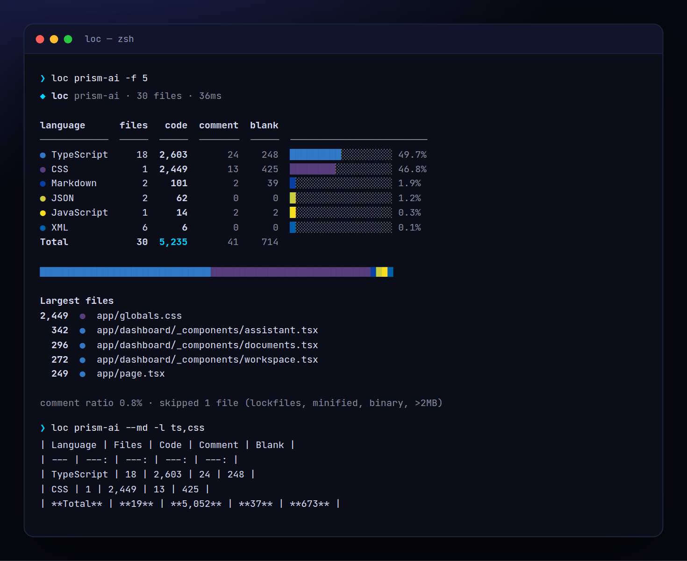

<!-- ═════════════ HEADER ═════════════ -->
<p align="center">
  
</p>

<p align="center">
  
</p>

<p align="center">
  <a href="https://github.com/krishyaa06/prism-loc/actions/workflows/ci.yml"></a>
  
  
  <a href="LICENSE"></a>
</p>

<p align="center">
  
</p>


## ⚡ Overview

**Prism LOC** (`loc`) answers "how big is this codebase?" in milliseconds. It walks your project (respecting `.gitignore`, skipping `node_modules`, builds, lockfiles, minified and binary files), detects 38 languages and splits every file into code, comment and blank lines with block-comment and string awareness. The output uses GitHub's language colours, and `--md` gives you a table ready to paste into a README.

## ✨ Features

- **38 languages** from TypeScript, Python, Go and Rust to Solidity, Prisma, Svelte and Astro
- **Code / comment / blank** with block comments, docstrings and strings handled
- **GitHub language colours**, share bars and a language strip
- `-f [n]` largest files, `-l ts,py` filter, `-e` extra excludes, `-s` sort
- `--md` markdown table for READMEs, `--json` for scripts and dashboards
- Respects `.gitignore`; skips lockfiles, `.min.*`, binaries and files over 2 MB; zero dependencies

## 🚀 Quick Start

```bash
# run without installing
npx github:krishyaa06/prism-loc 

# or install globally
npm install -g github:krishyaa06/prism-loc
loc -f 10
```

Requires Node.js 18.17+. No dependencies.

## 🛠️ Usage

```text
loc [dir] [options]

  -f, --files [n]        top n largest files (default 10)
  -l, --lang <list>      only these languages (ts,js,py,…)
  -e, --exclude <glob>   extra ignore pattern (repeatable)
  -s, --sort <key>       code | lines | files | comment (default code)
      --no-gitignore     don't read .gitignore
      --json             machine-readable output
      --md               markdown table (for READMEs)
```

Example `--md` output:

| Language | Files | Code | Comment | Blank |
| --- | ---: | ---: | ---: | ---: |
| TypeScript | 18 | 2,603 | 24 | 248 |
| CSS | 1 | 2,449 | 13 | 425 |
| **Total** | **30** | **5,235** | **41** | **714** |

## 📁 Project Structure

```text
prism-loc/
├── assets/
│   ├── logo.png
│   └── logo.svg
├── bin/
│   └── loc.js   # CLI entry
├── src/
│   ├── index.js   # walker + line classifier
│   ├── langs.js   # 38 language definitions
│   ├── ui.js   # colours, tables
│   └── walk.js
├── test/
│   └── loc.test.js
├── .gitignore
├── LICENSE
└── package.json
```

## 🧪 Tests

```bash
npm test
```

Tests use the built-in `node:test` runner, so there is nothing to install. CI runs them on Node 20 and 22.

## 🤝 Contributing

1. Fork the repo and create a branch: `git checkout -b feature/my-idea`
2. Make your change and add a test in `test/`
3. Run `npm test` and open a Pull Request

## 🔷 Part of Prism Protocol

Prism LOC is one of the open-source tools built by [Prism Protocol](https://dc.gg/prismprotocol), a tech community where young builders learn, ship and compete together.

## 👤 Author

<table>
  <tr>
    <td align="center">
      <a href="https://github.com/krishyaa06"><br><b>Soumya Bhandare</b></a><br>
      <sub>Founder @ Prism Protocol</sub>
    </td>
    <td>
      <a href="https://dc.gg/prismprotocol"></a><br>
      <a href="https://instagram.com/prism_protocol_"></a><br>
      <a href="https://x.com/krishyaa06"></a>
    </td>
  </tr>
</table>

## 📄 License

Released under the [MIT License](LICENSE).

<p align="center">
  <b>If you like this project, consider giving it a ⭐</b><br>
  <sub>"Build. Create. Compete." · Made with ⚡ by Prism Protocol</sub>
</p>


